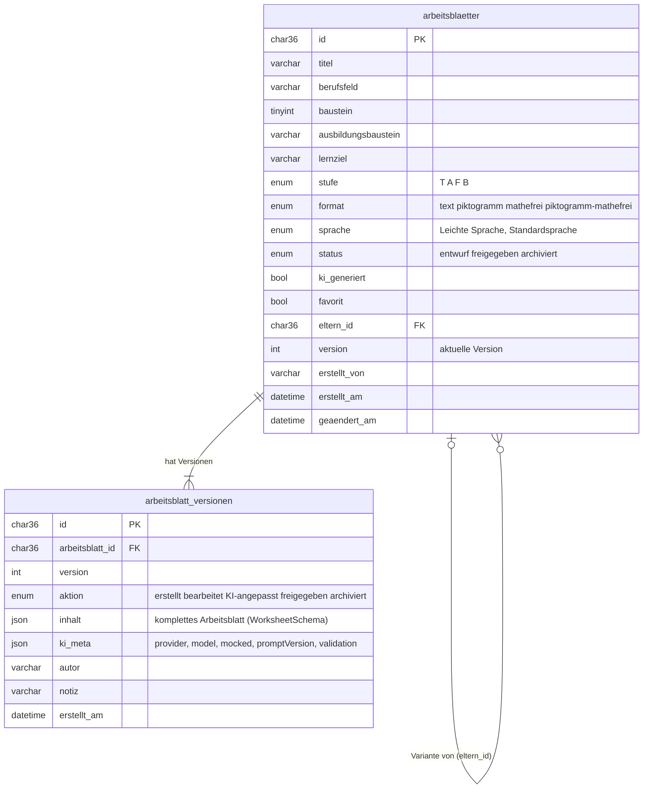

# Arbeitsblätter speichern – MySQL-Schema und API

**Stand:** 28.10.2026 · **Verantwortlich:** AP4 Backend (Sinan Oturucu, Thomas Neumann) · **Trello:** „MySQL DB Aufsetzen“, „Speichern von Arbeitsblättern“, „Arbeitsblätter Liste“, „Suche und Filter (Backend)“

Diese Seite beschreibt, wie generierte Arbeitsblätter in MySQL landen und wie das Frontend sie
abruft. Die Generierung selbst steht in [prototyp-ki-arbeitsblatt.md](prototyp-ki-arbeitsblatt.md).

---

## 1. Modell in einem Satz

Ein gespeichertes Arbeitsblatt ist **ein Lernziel in genau einer Stufe (T/A/F/B), einem Format und
einer Sprache** – also genau das, was `POST /api/ai/arbeitsblatt` liefert. Varianten desselben
Lernziels (andere Stufe, anderes Format) verweisen über `elternId` auf das zuerst gespeicherte Blatt.
Jede Änderung an Inhalt oder Status schreibt eine neue, unveränderliche **Version** (Verlauf).



Die Spalten `titel … sprache` sind Kopien aus `inhalt` der aktuellen Version, damit Liste, Filter und
Suche ohne JSON-Zugriff funktionieren. `users` bleibt wie am 16.10. angelegt (Anmeldung offen).
Die vier Beispieltabellen vom 16.10. (`worksheets`, `level_contents`, `history_entries`,
`stored_documents`) wurden nie beschrieben und sind durch Migration 001 entfernt.

**Schema-Änderungen** laufen über Migrationen: `apps/backend/db/migrations/NNN_name.sql`, nur
`CREATE TABLE IF NOT EXISTS` / `ALTER TABLE` / `DROP TABLE IF EXISTS`. Bestehende Dateien nie ändern,
immer eine neue Nummer. Angewendet wird automatisch beim Backend-Start oder per `npm run db:migrate`
(Protokoll in `schema_migrations`). `docker/mysql/init/01-init.sql` legt nur noch Datenbanken und Rechte an.

---

## 2. MySQL lokal

| Weg | Befehle | Verbindung für `npm run dev` |
|---|---|---|
| **Docker (Standard)** | `cp .env.example .env` · `docker compose up -d db` | automatisch: Backend liest `MYSQL_*` und `MYSQL_PORT=3307` aus der Root-`.env` |
| Eigene MySQL 8.4 | `CREATE DATABASE bildungspark CHARACTER SET utf8mb4 COLLATE utf8mb4_unicode_ci;` `CREATE USER 'bildungspark'@'%' IDENTIFIED BY 'bildungspark-dev';` `GRANT ALL ON bildungspark.* TO 'bildungspark'@'%';` | in der `.env`: `DB_HOST=127.0.0.1`, `DB_PORT=3306` (DB_* hat Vorrang vor MYSQL_*) |

Danach in `apps/backend`:

```bash
npm run db:migrate            # Tabellen anlegen bzw. aktualisieren
npm run db:seed               # Beispiel-Blätter: 24 mit importierten Lehrplänen, sonst 16 (4 eingebaute Lernziele); nur in eine leere Tabelle
npm run db:seed -- --reset    # alles löschen und neu befüllen
npm run dev                   # Start: migriert selbst, meldet "MySQL erreichbar"
```

Der Seed nutzt den Mock der Generierung (kein API-Key nötig) und die importierten Lehrpläne
(`npm run import:lehrplaene`, 6 Lernziele × 4 Stufen = 24 Blätter); ohne Import vier eingebaute Lernziele (16 Blätter, also mehr als eine Seite). Ohne erreichbare MySQL laufen
die KI-Routen weiter, `/api/arbeitsblaetter` antwortet mit `503 db_unavailable` und einem Hinweis.

---

## 3. API

Basis `/api/arbeitsblaetter`. Fehler wie überall: `{ error, message, details? }` mit deutscher Meldung
(`validation_error` 400, `not_found` 404, `db_unavailable` 503).

| Methode & Pfad | Zweck | Antwort |
|---|---|---|
| `GET /` | Liste, gefiltert und geblättert, **ohne Inhalt** | `{ eintraege[], seite, proSeite, gesamt, seiten }` |
| `GET /filteroptionen` | Werte für Dropdowns (nur nicht archivierte Blätter) | `{ berufsfelder[], bausteine[{berufsfeld, baustein, ausbildungsbaustein, anzahl}] }` |
| `POST /` | Speichern – Body `{ worksheet, meta?, erstelltVon?, elternId?, status?, favorit?, notiz? }` | `201 { arbeitsblatt }` mit `inhalt`, Header `Location` |
| `GET /:id` | Ein Blatt mit `inhalt` (aktuelle Version) | `{ arbeitsblatt }` |
| `PATCH /:id` | `{ worksheet?, status?, favorit?, aktion?, meta?, autor?, notiz? }` – mindestens eines von worksheet/status/favorit; `meta` nur mit `worksheet` | `{ arbeitsblatt }` |
| `DELETE /:id` | Archivieren (Status + Verlaufseintrag); Body optional `{ autor?, notiz? }` | `{ arbeitsblatt }` |
| `DELETE /:id?endgueltig=true` | Endgültig löschen (inkl. Verlauf) | `204` |
| `GET /:id/verlauf` | Versionen, neueste zuerst (`?inhalt=true` mit Inhalt) | `{ eintraege[{version, aktion, autor, notiz, kiMeta, erstelltAm}] }` |
| `GET /:id/versionen/:nr` | Eine Version mit Inhalt | `{ version }` |
| `GET /:id/docx` | Aktuelle Version als Word-Datei | `.docx` (Content-Disposition) |

**Filter von `GET /`** (alle optional): `q` (Suche in Titel, Lernziel, Ausbildungsbaustein, Berufsfeld),
`berufsfeld`, `baustein`, `ausbildungsbaustein`, `stufe`, `format`, `sprache` (Kommalisten: `stufe=T,A`),
`status` (Standard: alles außer `archiviert`; `alle` zeigt alles), `favorit`, `kiGeneriert`, `elternId`,
`sortierung` (`neueste` | `aelteste` | `titel`), `seite` (ab 1), `proSeite` (Standard 15, höchstens 100).

**Versionsregeln von `PATCH`:** neuer `worksheet` → Version +1 mit Aktion `bearbeitet` (oder
`KI-angepasst`, wenn `aktion` so gesetzt ist); neuer `status` → Version +1 mit Aktion `freigegeben` /
`archiviert` / `bearbeitet` (zurück auf Entwurf); nur `favorit` → keine neue Version.
`kiGeneriert` ist wahr, sobald beim Speichern `meta` mitkommt oder eine Version `KI-angepasst` (bzw. mit `meta`) angelegt wird – auch im Mock-Modus; `kiMeta.mocked` sagt, ob es eine Beispielantwort war. Gleichzeitige Änderungen am selben Blatt werden per Zeilensperre nacheinander ausgeführt.

**Beispiel – Ergebnis der Generierung speichern** (Frontend: `saveArbeitsblatt()` in `lib/api.ts`):

```bash
curl -s localhost:3000/api/ai/arbeitsblatt -H 'Content-Type: application/json' -d @anfrage.json > ergebnis.json
jq '{worksheet, meta, erstelltVon: "S. Oturucu"}' ergebnis.json \
  | curl -s localhost:3000/api/arbeitsblaetter -H 'Content-Type: application/json' -d @-
curl -s 'localhost:3000/api/arbeitsblaetter?berufsfeld=Lagerlogistik,%20Handel%20%26%20Versand&stufe=T,A&seite=1'
```

---

## 4. Was das Frontend jetzt bauen kann (Trello „Liste erstellter Arbeitsblätter“)

Funktionen in `apps/frontend/src/lib/api.ts`: `fetchArbeitsblaetter(filter)`, `fetchArbeitsblattFilteroptionen()`,
`fetchArbeitsblatt(id)`, `saveArbeitsblatt(input)`, `updateArbeitsblatt(id, patch)`, `deleteArbeitsblatt(id)`,
`fetchArbeitsblattVerlauf(id)`, `downloadGespeichertesDocx(blatt)`.

| Akzeptanzkriterium der Karte | Aufruf |
|---|---|
| „Aufbau“ aufklappbar → Details | `fetchArbeitsblatt(id)` → `inhalt.aufgaben`, `inhalt.woerterbuch` |
| Vorschau-Button | `fetchArbeitsblatt(id)` → `GeneratedWorksheetCard` wiederverwenden |
| Verlauf-Button | `fetchArbeitsblattVerlauf(id)` |
| docx-Button | `downloadGespeichertesDocx(blatt)` |
| KI-Anpassung-Button | `generateArbeitsblatt(...)` → `updateArbeitsblatt(id, { worksheet, meta, aktion: 'KI-angepasst' })` |
| Paginiert ab 15 | `fetchArbeitsblaetter({ seite })` → `seiten`, `gesamt` |
| Speichern nach Generierung (Karte #8) | `saveArbeitsblatt({ worksheet, meta, erstelltVon })` |

---

## 5. Tests und Dateien

- `tests/integration/arbeitsblaetter-routes.test.js` – 30 Fälle gegen echte MySQL (bricht ab, wenn die verbundene Datenbank nicht auf `_test` endet) (CI-Job `backend-integration`, lokal mit `DB_HOST=127.0.0.1 DB_PORT=3307 DB_NAME=bildungspark_test DB_USER=bildungspark DB_PASSWORD=bildungspark-dev npm run test:run`); ohne `DB_HOST` übersprungen, dafür wird das 503-Verhalten geprüft.
- `tests/unit/arbeitsblaetter-schema.test.js`, `arbeitsblaetter-repository.test.js`, `migrate.test.js` – ohne Datenbank.
- Code: `src/routes/arbeitsblaetter.js` (HTTP), `src/arbeitsblaetter/schema.js` (zod), `src/arbeitsblaetter/repository.js` (SQL), `src/arbeitsblaetter/seed.js`, `src/db/migrate.js`, `db/migrations/001_arbeitsblaetter.sql`.

**Offen:** Anmeldung (`erstelltVon` ist bis dahin ein freier Name), Upload von Originaldokumenten
(`stored_documents` kommt mit dem Upload-Ticket als Migration 002 zurück), Volltextsuche statt `LIKE`,
Teilnehmer-Zuordnung.
