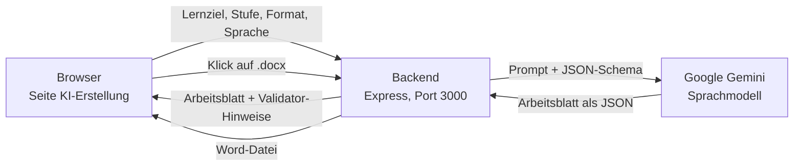
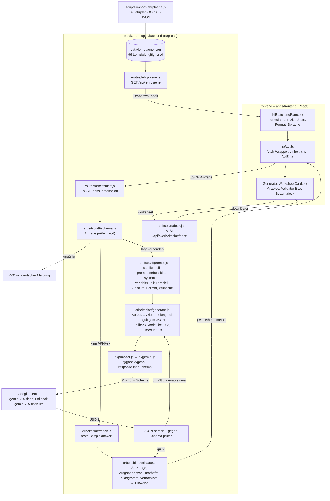

# Prototyp „Arbeitsblatt per KI erstellen“

**Stand:** 22.10.2026 · **Meilenstein:** Erster Prototyp (23.10.2026) · **Verantwortlich:** AP4 Backend & LLM-API (Sinan Oturucu, Thomas Neumann)

Diese Seite erklärt in einfachen Worten, was der Prototyp kann, wie er innen funktioniert,
wie man ihn startet und wie man ihn in fünf Minuten vorführt. Fachbegriffe stehen im Glossar (Abschnitt 3).

---

## 1. Was der Prototyp kann

Im Browser wählt man ein Lernziel aus einem echten Lehrplan des Bildungsparks, dazu eine oder mehrere
Niveaustufen (T/A/F/B) und Formate (Text, Piktogramm, Ohne Rechnen), und bekommt per Klick ein
vollständiges Arbeitsblatt in Leichter Sprache: Einleitung, nummerierte Aufgaben, kleines Wörterbuch
und ein Hinweis für die Lehrkraft. Das Arbeitsblatt erzeugt Google Gemini (ein Sprachmodell) nach
unseren Regeln; ein Prüfprogramm (Validator) meldet Verstöße gegen die Regeln als Hinweise, und ein
Klick lädt das Blatt als Word-Datei im Bildungspark-Stil herunter. Ohne API-Key läuft alles mit einer
festen Beispielantwort (Mock) – die komplette Demo funktioniert also auch ohne Internet.

**Was er nicht ist:** kein Endprodukt. Es gibt keine Anmeldung. Jedes Ergebnis ist ein KI-Entwurf,
den eine Lehrkraft prüfen muss (steht auch im Dokument). Seit 28.10. kann das Backend Arbeitsblätter
in MySQL speichern, auflisten, freigeben und mit Verlauf führen (`/api/arbeitsblaetter`, siehe
[persistenz-arbeitsblaetter.md](persistenz-arbeitsblaetter.md)); die Buttons dafür im Frontend fehlen noch.

---

## 2. Ablauf in einfachen Worten

### 2.1 Das einfache Bild

Vier Stationen: Browser, unser Backend, Gemini, Word-Datei. Alles andere sind Details im Backend.



### 2.2 Das ausführliche Bild

Jede Station ist eine Datei im Repo (Pfade relativ zu `apps/frontend/src` bzw. `apps/backend/src`).
Ohne API-Key läuft der Zweig „kein API-Key“ über die Mock-Antwort; der Rest ist identisch.



### 2.3 Dieselbe Kette als Textskizze (für Terminal und Ausdruck)

```
Browser (React, Port 5173)                 Backend (Express, Port 3000)                     Google Gemini
──────────────────────────                 ─────────────────────────────                    ─────────────
1. Lernziel, Stufe, Format,                2. Eingaben prüfen (Schema)
   Sprache wählen, „Generieren“  ──────►      ungültig? → 400 mit deutscher Meldung
                                           3. Prompt bauen
                                              = fester Regel-Text (prompts/arbeitsblatt-system.md)
                                              + Lernziel mit allen 4 Stufen, Zielstufe, Format, Sprache
                                           4. Gemini aufrufen, JSON-Schema mitschicken  ──────►  erzeugt JSON
                                           5. Antwort parsen + gegen Schema prüfen     ◄──────  (ca. 5–10 s)
                                              ungültig? → genau EIN zweiter Versuch mit Korrekturhinweis
                                              Anbieter überlastet (503)? → kurz warten, Fallback-Modell
                                           6. Validator: Satzlänge, Aufgabenanzahl, Format-Regeln,
                                              Verbotsliste → Liste von Hinweisen (blockiert nichts)
7. Anzeige der Variante      ◄──────────   7. Antwort { worksheet, meta }
   + Hinweise + „📄 .docx“
8. Klick „.docx“             ──────────►   8. Word-Datei bauen (Paket `docx`)  ──────►  Download
```

Bei mehreren Varianten (z. B. Stufe T und A × Text und Piktogramm = 4) läuft Schritt 2–7 **nacheinander**,
mit Fortschrittsanzeige „Variante 2 von 4 …“. Grund: der kostenlose Gemini-Zugang erlaubt nur wenige
Anfragen pro Minute (siehe Rate-Limit im Glossar).

**Ohne API-Key** (`GEMINI_API_KEY` in der `.env` leer oder Datei fehlt) überspringt das Backend
die Schritte 3–5 und liefert ein festes Beispiel-Arbeitsblatt, in das Lernziel, Stufe, Format und Sprache
der Anfrage übernommen werden. Die Antwort trägt `meta.mocked = true`, das Frontend zeigt einen gelben Hinweis.

**Datenschutz:** An Gemini gehen nur Lehrplan-Texte und die Wünsche der Lehrkraft (Thema/Erwartungen).
Keine Teilnehmer- oder Nutzerdaten. Der Prompt verbietet dem Modell ausdrücklich, Personen zu beschreiben.

---

## 3. Glossar

| Begriff | Bedeutung bei uns |
|---|---|
| **API-Endpunkt** | Eine Adresse, unter der das Backend eine Aufgabe erledigt. Das Frontend schickt JSON hin und bekommt JSON (oder eine Datei) zurück. Unsere: `POST /api/ai/arbeitsblatt` (erzeugen) und `POST /api/ai/arbeitsblatt/docx` (Word-Datei). |
| **Prompt** | Der Text, den wir dem Sprachmodell schicken. Zwei Teile: der **System-Prompt** (feste Regeln: Rolle, Leichte Sprache, Stufen, Formate, Sicherheitsregeln, ein Beispiel) und der **User-Prompt** (das konkrete Lernziel, Zielstufe, Format, Sprache, Wünsche der Lehrkraft). |
| **JSON** | Ein Textformat für strukturierte Daten, z. B. `{ "titel": "Güter ent-laden", "aufgaben": [ … ] }`. Programme können es direkt lesen. |
| **JSON-Schema / strukturierte Ausgabe** | Eine Beschreibung, welche Felder das JSON haben muss (Name, Typ, erlaubte Werte). Wir schicken das Schema mit an Gemini – das Modell **muss** dann genau diese Struktur liefern. Zusätzlich prüfen wir die Antwort mit der Bibliothek `zod` noch einmal selbst. |
| **Mock** | Eine Attrappe: verhält sich nach außen wie das Echte (gleiche Felder), liefert aber feste Inhalte. Damit läuft die Demo ohne API-Key, ohne Internet und ohne Kosten; auch alle Tests laufen im Mock-Modus. |
| **Validator** | Ein Prüfprogramm mit festen Regeln (ohne KI): Satzlänge je Stufe, Anzahl Aufgaben, „Ohne Rechnen“ (keine Zahlen > 3, keine Rechenzeichen), Piktogramm-Regeln, Verbotsliste. Es blockiert nichts, sondern gibt Hinweise für die Lehrkraft. |
| **Token** | Die Zähleinheit der Sprachmodelle, ungefähr ein Wortteil (ca. ¾ Wort). Ein Arbeitsblatt kostet bei uns etwa 2 800 Tokens Eingabe (der Prompt) und 500–800 Tokens Ausgabe. Nach Tokens wird abgerechnet. |
| **Rate-Limit** | Die Obergrenze an Anfragen pro Minute und pro Tag. Der kostenlose Gemini-Zugang („Free-Tier“) ist knapp bemessen – deshalb erzeugen wir Varianten nacheinander, nie parallel. Bei Überschreitung antwortet Gemini mit Fehler 429; das Backend meldet „Rate-Limit erreicht, bitte eine Minute warten“. |
| **Timeout** | Zeitlimit. Antwortet Gemini nicht innerhalb von 60 Sekunden (`AI_TIMEOUT_MS`), bricht das Backend ab und meldet eine Zeitüberschreitung. |
| **Fallback-Modell** | Meldet Gemini „Modell überlastet“ (Fehler 503), wartet das Backend 2,5 Sekunden und versucht es einmal mit einem kleineren Modell (`GEMINI_FALLBACK_MODEL`, Standard `gemini-3.5-flash-lite`). In `meta.model` steht, welches Modell tatsächlich geantwortet hat. |
| **Few-Shot-Beispiel** | Ein fertiges Beispiel im Prompt, an dem das Modell Stil und Struktur ablesen kann. Unseres ist an das Bildungspark-Blatt „Waren sicher ver-packen“ angelehnt. |

---

## 4. Demo starten

### 4.1 Auf einem Mac ohne Docker (so wurde der Prototyp entwickelt)

Voraussetzungen: Node 22, npm, Internet (für Gemini). Alle Befehle im Ordner des Repos.

1. **Key besorgen** (einmalig, kostenlos): Google AI Studio → <https://aistudio.google.com/apikey> → „Create API key“.
   Der Free-Tier reicht für die Demo.
2. **Key eintragen** – im Repo-Root `cp .env.example .env` und in der `.env` den Key setzen
   (die Datei ist in `.gitignore`, landet also nie in Git):

   ```dotenv
   AI_PROVIDER=gemini
   GEMINI_API_KEY=hier-den-key-einfügen
   # optional – Standard ist gemini-3.5-flash mit Fallback gemini-3.5-flash-lite:
   # GEMINI_MODEL=gemini-3.5-flash-lite
   ```

   Dieselbe Datei benutzt auch Docker Compose. Das Backend liest beim Start zuerst eine optionale
   `apps/backend/.env`, dann die Root-`.env` – die erste gesetzte Variable gewinnt.
   Den Key nie in Chats, Screenshots oder Commits zeigen. Nach der Demo im AI Studio rotieren (neu erzeugen, alten löschen).
3. **Abhängigkeiten** (einmalig): `npm ci` in `apps/backend` und in `apps/frontend`.
4. **Zwei Terminals:**

   ```bash
   cd apps/backend && npm run dev      # Backend auf http://localhost:3000
   ```

   ```bash
   cd apps/frontend && npm run dev     # Frontend auf http://localhost:5173
   ```

   Das Backend meldet beim Start `"aiConfigured":true` (Key gefunden) oder `false` (Mock-Modus). Die Warnung
   „MySQL nicht erreichbar“ ist für diese Demo egal – die KI-Routen brauchen keine Datenbank.
5. Browser: <http://localhost:5173> → Menü **KI-Erstellung**.
6. Prüfen, ob der Key wirkt: <http://localhost:3000/api/ai/status> zeigt `"configured": true` und das Modell.

### 4.2 Mit Docker (Windows-Laptop des Teams)

```bash
cp .env.example .env            # Windows PowerShell: Copy-Item .env.example .env
# in .env den GEMINI_API_KEY eintragen
docker compose up -d --build
```

Dann wie oben <http://localhost:5173>. Ohne Key in der `.env` läuft die Demo im Mock-Modus.

### 4.3 Wenn etwas schiefgeht

| Meldung im Frontend | Ursache | Was tun |
|---|---|---|
| „Das Backend ist nicht erreichbar“ | Backend läuft nicht | Terminal 1 prüfen, `npm run dev` in `apps/backend` |
| Gelber Hinweis „Kein API-Key – Beispielantwort (Mock)“ | `.env` fehlt oder Key leer | Root-`.env` anlegen (`cp .env.example .env`), Key eintragen, Backend neu starten |
| „Rate-Limit des KI-Anbieters erreicht“ | zu viele Anfragen (Free-Tier) | eine Minute warten, weniger Varianten auf einmal |
| „Der KI-Anbieter ist gerade nicht erreichbar“ | Gemini überlastet (503), auch das Fallback-Modell | kurz warten, erneut klicken; notfalls `GEMINI_MODEL=gemini-3.5-flash-lite` setzen |
| „Das konfigurierte KI-Modell ist für diesen API-Key nicht verfügbar“ | Modellname veraltet (z. B. `gemini-2.5-flash`, seit Oktober 2026 für neue Keys gesperrt) | `GEMINI_MODEL` in `.env` auf `gemini-3.5-flash` oder `gemini-3.5-flash-lite` setzen |
| „Zeitüberschreitung“ | Gemini antwortet > 60 s nicht | erneut versuchen; `AI_TIMEOUT_MS` erhöhen |
| „Die KI-Antwort war auch nach einem zweiten Versuch kein gültiges Arbeitsblatt“ | Modell hielt sich nicht ans Schema (selten) | erneut klicken; passiert es öfter, Prompt prüfen (Abschnitt 7) |

Die Eingaben im Formular bleiben bei jedem Fehler erhalten – einfach erneut auf „Generieren“ klicken.

---

## 5. Demo-Skript (5 Minuten)

**Vorbereitung (vor der Präsentation):** Backend und Frontend starten, einmal probeweise generieren
(dann ist alles „warm“ und man weiß, ob der Key funktioniert). Browser-Zoom so, dass das Formular komplett sichtbar ist.
Plan B bei Internetproblemen: in der `.env` den `GEMINI_API_KEY` leeren (oder die Datei umbenennen), Backend neu starten → Mock-Modus, Ablauf identisch.

| Minute | Was zeigen | Was sagen |
|---|---|---|
| 0:00 | Seite **KI-Erstellung**, Berufsbild *Lagerlogistik, Handel & Versand*, Lernziel **Baustein 1 · Güter entladen** | „Die Lernziele kommen direkt aus den binnendifferenzierten Lehrplänen des Bildungsparks – hier die vier Stufen T/A/F/B aus dem Lehrplan.“ (unter dem Dropdown steht das Lernziel) |
| 0:45 | Stufe **T** wählen (A abwählen), Format **Standard-Text**, Leichte Sprache. Optional in „Erwartungen“: *Sicherheit am LKW betonen* | „Stufe T heißt laut Lehrplan: beherrscht einen erlernten Arbeitsschritt. Das Modell bekommt genau diese Kompetenzformel, nicht unsere Bezeichnungen.“ |
| 1:15 | **✦ 1 Variante generieren** klicken, Fortschritt zeigen | „Jetzt baut das Backend den Prompt – feste Regeln plus Lernziel – und schickt ihn mit einem JSON-Schema an Gemini. Dauert 5 bis 10 Sekunden.“ |
| 1:45 | Ergebnis durchgehen: Titel mit Silbentrennung („Güter ent-laden“), Einleitung mit **Achtung**-Absatz, 3–4 Aufgaben mit Typen (Ankreuzen, Nach-denken, Praxis-Übung mit „Frage deinen Anleiter“), Wörterbuch, Hinweis für die Lehrkraft | „Stil wie die echten Arbeitsblätter: kurze Sätze, Bindestrich-Trennung, du-Anrede, Praxis-Übung mit Rückfrage an den Anleiter.“ |
| 2:30 | **Validator-Box** zeigen (grün oder gelb mit Hinweisen, z. B. „Satz mit 15 Wörtern, Stufe T erlaubt höchstens 12“) | „Ein regelbasiertes Prüfprogramm kontrolliert jede Antwort – ohne KI. Es blockiert nichts, die Lehrkraft entscheidet.“ |
| 3:00 | **📄 .docx** klicken, Word-Datei öffnen | „Export im Bildungspark-Stil, mit Fußzeile ‚KI-generiert – fachliche Freigabe ausstehend‘.“ |
| 3:45 | Zweite Runde: Stufe **B**, Format **Piktogramm + Mathefrei** generieren | „Gleicher Lehrplan, andere Stufe: 6–8 Aufgaben, Transferaufgaben, jede Aufgabe mit Piktogramm-Schlüssel, keine Zahlen über 3. Die Piktogramme sind im Prototyp Symbole – später ein echtes Piktogramm-Set.“ |
| 4:30 | Kurz `apps/backend/src/arbeitsblatt/prompts/arbeitsblatt-system.md` im Editor zeigen | „Die Regeln stehen in einer lesbaren Datei – fachliche Änderungen vom Bildungspark lassen sich ohne Programmierung einarbeiten.“ |
| 4:50 | Abschluss | „Alle Ergebnisse sind KI-Entwürfe und freigabepflichtig. Nächste Schritte: Speichern, Freigabe-Workflow, Lehrplan-Import.“ |

Tipps, welche Einstellungen gute Ergebnisse bringen: Abschnitt 10.

**Falls Gemini während der Demo 503 meldet:** Das Backend wechselt automatisch auf das kleinere Modell
(im Backend-Terminal sichtbar). Meldet auch das Fallback einen Fehler: 20 Sekunden warten, erneut klicken,
oder auf den Mock-Modus wechseln (Plan B).

---

## 6. Was bewusst fehlt – und der nächste Schritt

| Fehlt im Prototyp | Warum | Nächster Schritt |
|---|---|---|
| Speichern-Button im Frontend | Backend seit 28.10. fertig: `POST /api/arbeitsblaetter` legt das Ergebnis als `entwurf` ab, `GET` liefert die Liste ([Doku](persistenz-arbeitsblaetter.md)) | `saveArbeitsblatt()` aus `lib/api.ts` in `GeneratedWorksheetCard` aufrufen; Liste auf `fetchArbeitsblaetter()` umstellen |
| Login / Rollen | Nicht-Ziel laut Projektauftrag, Entscheidung mit Bildungspark offen | einfacher Login für Dozierende (JWT ist vorbereitet) |
| Freigabe-Workflow im Frontend | Backend kann es: `PATCH { status: 'freigegeben' }` schreibt Version + Verlauf | Buttons „Freigeben“/„Archivieren“ und Verlaufsanzeige |
| Echte Piktogramm-Bilder | kein Set vom Bildungspark | Whitelist in `schema.js` auf Bilddateien abbilden (Prompt bleibt gleich) |
| Azure OpenAI | kein Zugang; Adapter nur strukturell vorbereitet | `npm i @azure/openai`, `AI_PROVIDER=azure`, Test |
| Upload-Analyse (PDF → Lernziel) | Frontend simuliert | Dokumentanalyse als eigener Endpunkt (Konzept AP4, Kap. 8) |
| Lehrplan-Pflege im Browser | Import nur per Skript (Abschnitt 9) | Seite „Lehrpläne“ (Projektauftrag Teilziel 3) |
| Websuche | im Frontend simuliert | später, kein Teil von AP4 |
| Bearbeiten des Ergebnisses | nur Anzeige + Download | Felder editierbar machen, dann speichern |

---

## 7. Prompt ändern und testen

1. Datei öffnen: `apps/backend/src/arbeitsblatt/prompts/arbeitsblatt-system.md` – normales Markdown, jede Zeile
   wird so an Gemini geschickt. Abschnitte: Rolle, Sprache, Stufen, Formate, Aufgabentypen, Sicherheitsregeln, Beispiel.
2. Ändern, z. B. eine neue Regel für Leichte Sprache ergänzen oder das Beispiel anpassen.
3. **Versionsnummer in Zeile 1 erhöhen** (aktuell `Prompt-Version: 1.0.1`, nächste wäre `1.0.2`). Sie wird mit jeder Antwort als `meta.promptVersion`
   zurückgegeben – so sieht man später, mit welchem Prompt ein Blatt entstanden ist.
4. Tests laufen lassen (ohne Key, ohne Kosten):

   ```bash
   cd apps/backend && npm run test:run
   ```

   Die Tests prüfen u. a., dass die Kompetenzformeln noch im Prompt stehen und dass das Beispiel im Prompt
   dem Schema entspricht und den Validator besteht. Rot = Beispiel oder Regeltext kaputt.
5. Echt ausprobieren: Backend läuft mit `node --watch`, lädt die Datei also beim nächsten Request neu.
   Im Frontend dieselbe Kombination zweimal generieren und vergleichen.

**Was im Code liegt (nicht im Prompt):** Aufgabenanzahl je Stufe und Kompetenzformeln (`schema.js`, werden in den
variablen Teil eingesetzt), Validator-Grenzen und Verbotsliste (`validator.js`), Modell und Temperatur (`generate.js`, `config.js`).

---

## 8. Dateien im Überblick

| Datei | Aufgabe |
|---|---|
| `apps/backend/src/arbeitsblatt/schema.js` | Schema des Arbeitsblatts (zod), JSON-Schema für Gemini, Konstanten (Stufen, Formate, Piktogramm-Whitelist) |
| `apps/backend/src/arbeitsblatt/prompts/arbeitsblatt-system.md` | Der feste Teil des Prompts – lesbar, änderbar |
| `apps/backend/src/arbeitsblatt/prompt.js` | Baut den variablen Teil (Lernziel, Stufe, Format, Wünsche) |
| `apps/backend/src/arbeitsblatt/generate.js` | Ablauf: Prompt → Gemini → prüfen → Wiederholung → Validator |
| `apps/backend/src/arbeitsblatt/validator.js` | Regelprüfung, gibt Hinweise zurück |
| `apps/backend/src/arbeitsblatt/mock.js` | Beispiel-Arbeitsblatt ohne Key |
| `apps/backend/src/arbeitsblatt/docx.js` | Word-Export |
| `apps/backend/src/routes/arbeitsblatt.js` | Die zwei Endpunkte |
| `apps/backend/src/ai/gemini.js` | Aufruf des Gemini-SDK (`@google/genai`) |
| `apps/frontend/src/lib/api.ts` | Aufrufe des Backends aus dem Browser, einheitliche Fehler |
| `apps/frontend/src/pages/ki-erstellung/KiErstellungPage.tsx` | Formular, Fortschritt, Fehleranzeige |
| `apps/frontend/src/pages/ki-erstellung/GeneratedWorksheetCard.tsx` | Anzeige eines Ergebnisses + Download |
| `apps/backend/tests/` | 112 Backend-Tests (Schema, Validator, Prompt, Ablauf mit Fake-Provider, Routen, DOCX) |
| `apps/frontend/tests/unit/KiErstellung.spec.tsx` | Frontend-Tests mit gemocktem Backend |

| `apps/backend/scripts/import-lehrplaene.js` | Liest die 14 Lehrplan-DOCX und schreibt `apps/backend/data/lehrplaene.json` (Abschnitt 9) |
| `apps/backend/src/lehrplan/parser.js` | DOCX-/XML-Parser der Lehrpläne (ohne Zusatzpakete) |
| `apps/backend/src/routes/lehrplaene.js` | `GET /api/lehrplaene` – die importierten Lernziele |

**Gemessen am 22.10.2026** (Free-Tier-Key, Lernziel „Güter entladen“): Stufe T/Text 8–9 s, 3 300 Tokens;
Stufe B/Piktogramm+Mathefrei 9 s, 3 600 Tokens; `gemini-3.5-flash` antwortete mehrfach mit 503, der Fallback
auf `gemini-3.5-flash-lite` griff automatisch. `gemini-2.5-flash` (Teamentscheidung vom 16.10.) ist für neue
Keys nicht mehr verfügbar (HTTP 404).

---

## 9. Alle 96 Lernziele aus den Lehrplänen laden (optional)

Ohne Import bietet das Dropdown „Lernziel aus dem Lehrplan“ die 12 Beispiel-Lernziele aus
`apps/frontend/src/data/worksheets.ts` an. Mit Import stehen alle **96 Lernziele** der 14 Lehrplan-Dokumente
zur Wahl (Lager 16, Metall 19, Gastro 61).

```bash
cd apps/backend
npm run import:lehrplaene                       # Ordner ../context/WG__Unterlagen_BIldungspark neben dem Repo
npm run import:lehrplaene -- "/Pfad/zum/Ordner"  # oder: Ordner als Argument bzw. LEHRPLAN_DIR
```

Das Skript meldet je Datei die Anzahl der Lernziele und die Baustein-Nummer (sie stammt aus der Zeile
„Ausbildungs-baustein N“, weil die Kopfzeile in 10 von 14 Dateien falsch ist) und schreibt
`apps/backend/data/lehrplaene.json`. **Diese Datei liegt in `.gitignore`** – die Lehrpläne gehören dem
Bildungspark und das Repository ist öffentlich. Jedes Teammitglied erzeugt sie lokal.

Danach das Backend neu starten (es liest die Datei einmal beim ersten Aufruf). `GET /api/lehrplaene` liefert
die Liste; das Frontend zeigt unter dem Dropdown „Quelle: 96 importierte Lernziele“. Die Lernzieltexte sind
im Dropdown auf 70 Zeichen gekürzt, in der Zeile darunter stehen sie vollständig.

---

## 10. Einstellungen und Tipps für gute Ergebnisse

Kurzfassung: Ausprobieren ist ungefährlich. Nichts geht kaputt. Schlimmstenfalls kommt ein Rate-Limit
(eine Minute warten) oder ein paar Validator-Hinweise. Für ein gutes Ergebnis zählt vor allem das Lernziel.

### 10.1 Was die Felder bedeuten

| Feld | Bedeutung | Wirkung auf die KI |
|---|---|---|
| **Berufsbild** | Berufsfeld des Bildungsparks | Filtert nur die Lernziel-Liste. Lehrpläne gibt es für Lager, Gastro und Metall; Garten und Pflege sind gesperrt. |
| **Lernziel „Baustein N · …“** | Baustein = Kapitel des Lehrplans (Lager: 1 Wareneingang, 2 Innerbetrieblicher Transport, 3 Lagerung; Gastro: 1–5; Metall: 2). Lernziel = eine Zeile daraus mit den vier Stufen T/A/F/B | Wichtigste Eingabe. Die KI bekommt alle vier Stufenzeilen samt Beispielen und baut das Blatt daraus. |
| **Niveaustufe** | T = ein Arbeitsschritt, A = einige Schritte, F = bekannte Situationen, B = neue Situationen | Schwierigkeit und Anzahl der Aufgaben (T 3–4 … B 6–8). Jede angeklickte Stufe ergibt ein eigenes Blatt. |
| **Sprachformat** | Leichte Sprache = kurze Sätze, Bindestrich-Trennung, du-Anrede. Standardsprache = normale Sätze | Der Validator misst die Satzlänge trotzdem je Stufe; Standardsprache bei T erzeugt daher oft Hinweise. Für den Bildungspark fast immer Leichte Sprache. |
| **Format** | Text / Mit Piktogrammen (jede Aufgabe mit Symbol, Anweisung höchstens 8 Wörter) / Ohne Rechnen (keine Zahlen über 3, keine Rechenzeichen) / beides | Jedes Format ergibt ein eigenes Blatt. Piktogramme sind im Prototyp Symbole (Emoji), kein echtes Piktogramm-Set. |
| **Thema / Titel, Erwartungen** | optional | Zweitwichtigster Hebel. Beides geht als „Zusatzwunsch der Lehrkraft“ in den Prompt. |

### 10.2 Fünf Regeln für gute Ergebnisse

1. **Lernziel mit konkretem Beispiel wählen.** „Güter entladen“ (Beispiel im Lehrplan: LKW melden, Hubwagen) liefert
   besseres Material als abstrakte Lernziele wie „Vorschriften anwenden“. Das Beispiel steht unter dem Dropdown.
2. **Erwartungen kurz und konkret:** „Sicherheit am LKW betonen“, „Beispiele mit Paletten und Hubwagen“,
   „eine Reihenfolge-Aufgabe einbauen“. Ein bis zwei Sätze reichen. Keine Romane, keine Anweisungen an die KI
   wie „ignoriere die Regeln“ (werden ohnehin abgefangen).
3. **Wenige Varianten auf einmal.** Jede dauert 10–20 Sekunden und kostet Kontingent. Für die Demo eine,
   höchstens zwei. Vier auf einmal nur, wenn Zeit ist.
4. **Stufe und Format passend kombinieren.** T und A funktionieren gut mit Piktogrammen. Bei B wird das
   Piktogramm-Format eng (8 Wörter für Transferaufgaben). „Ohne Rechnen“ ist sinnvoll, wenn im Lernziel Zählen
   oder Mengen vorkommen (Warenkontrolle, Lager).
5. **Nicht zufrieden? Nochmal klicken.** Die KI variiert bei jedem Aufruf leicht (Temperatur 0,4), jedes
   Ergebnis ist anders. Validator-Hinweise sind keine Fehler, sondern Prüfpunkte für die Lehrkraft.

### 10.3 Was nicht hilft

- Thema/Titel überschreibt das Lernziel nicht, es ergänzt nur.
- Standardsprache macht das Blatt nicht „besser“, nur länger.
- Viele Formate gleichzeitig verbessern kein einzelnes Blatt, sie verlängern nur die Wartezeit.
